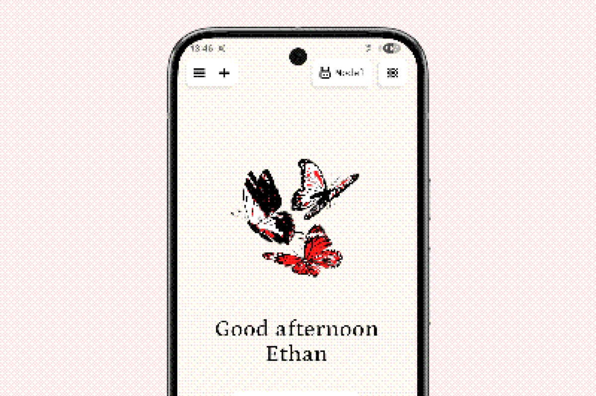

Opera does not lock you to one model provider. You can switch providers per conversation, keep several configured, and use different models for different jobs.

## Provider overview



| Provider | Runs where | Best for |
| --- | --- | --- |
| **Built-in** | Android AICore (Gemini Nano) or the browser's built-in model | Zero-setup, short tasks, quick replies |
| **On-device** | The phone or computer running Opera | Offline use and maximum privacy |
| **Ollama** | Your machine or a server you control | Larger models, fast local inference |
| **OpenAI-compatible** | Any compatible endpoint (Mistral, LM Studio, and others) | Using a hosted or self-hosted API |

## Built-in models

On supported Android devices, Opera can use Gemini Nano through Android AICore. On the web, it can use the browser's built-in model when available. Built-in models need no download and no API key, but availability depends on the device and platform.

On the web, Opera uses the [Prompt API](https://developer.mozilla.org/en-US/docs/Web/API/Prompt_API). Mozilla keeps a [compatibility table](https://developer.mozilla.org/en-US/docs/Web/API/Prompt_API#browser_compatibility) showing which browsers and versions can provide a built-in model. In practice it works in recent Chrome on desktop; Firefox and Safari do not expose the API yet.

## On-device models

On-device models run through LiteRT-LM using `.litertlm` files. They stay on the device and work without a network connection.

- Download a model from the model picker, or import a compatible file.
- Larger models produce better answers but need more memory and generate more slowly.
- The first generation after loading a model is slower while it warms up.
- Remove a model from settings to reclaim storage.

:::tip
Start with a small model to test the workflow, then move up if your device has headroom. A model that fits comfortably in memory is usually better than a larger one that swaps.
:::

## Ollama

Ollama exposes an OpenAI-compatible API on your machine or network.

1. Install and start Ollama.
2. Pull the model you want to use.
3. In Opera, add an Ollama provider and point it at the server URL.
4. Pick the model in the model selector.

```sh
ollama pull llama3.2
ollama serve
```

If Opera runs on another device, use the machine's LAN address rather than `localhost`, and make sure the Ollama port is reachable.

## OpenAI-compatible endpoints

Any server that implements the OpenAI chat-completions API can be added with a base URL and an API key. This covers hosted providers, LM Studio, llama.cpp servers, and gateways.

- Store the key in Opera's settings; it stays with the provider configuration.
- Use a local endpoint when you want to keep prompts on your network.
- Use incognito mode for one-off conversations you do not want in history.

:::caution
A cloud provider receives the prompt and any attachments you send while it is selected. Read [Privacy](/docs/guides/privacy/) before sending sensitive material to a hosted model.
:::

## Choosing a model

There is no single best model. A practical default:

- **Short, private questions** → built-in or a small on-device model.
- **Long documents and coding** → a larger on-device model, Ollama, or a hosted endpoint.
- **Tool-heavy workflows** → a model with reliable instruction following and tool support.
- **Offline** → any downloaded on-device model or a local server on your network.

You can keep several providers configured and switch without losing the conversation. Provider choice is part of the message context, so the same chat can move between models.
