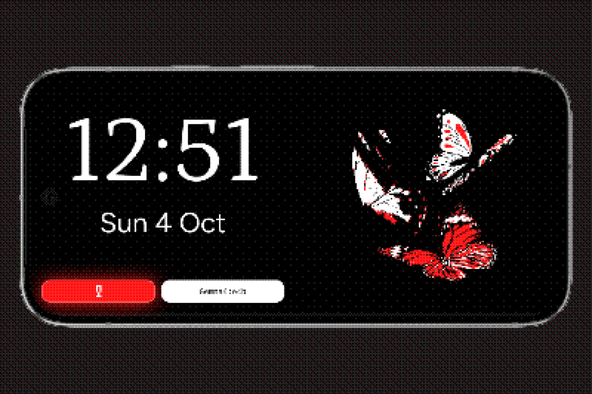

Stand-by turns your device into a small smart display. While it charges or sits idle, the screen shows the time, the date and Maestro's butterflies. Ask a question out loud: Maestro answers in a few spoken sentences and puts the key facts on a card next to the clock.

On Android, Stand-by is Opera's screen saver. In the browser, the same screen opens at `/standby` in Opera.

## Turn it on

1. In Opera, open **Settings → Screen Saver**.
2. Tap **Open screen saver settings**. This opens Android's screen saver page.
3. Choose **Opera** as the screen saver, then pick when it starts: while charging, while docked, or both.

The device shows Stand-by the next time it charges or docks with the screen idle.

## What you need

- **A model.** Stand-by uses the model you pick with the **Model** button at the bottom of the screen. Any provider works: on-device, Ollama, Sampler Hub or an OpenAI-compatible endpoint.
- **A Whisper model** to understand your voice. Install one in Opera's settings. Without it, the microphone and the wake word stay off.
- **Maestro's voice** to read replies aloud. Download it in Opera's settings.

Stand-by tells you on screen when one of these is missing.

## Ask a question

Tap the microphone, or say **"Maestro"** if the wake word is on, then speak. Listening stops on its own after a short silence.

Replies are made for a screen across the room:

- **Short and spoken.** One to three sentences, the answer first, written to be heard: no lists, links or tables read out loud.
- **A card on screen.** Most answers come with a card: a picture of the subject, a few key facts, an optional list such as ingredients or steps, and a button for the obvious next action.
- **Follow-up questions.** When Maestro needs an answer from you, the microphone reopens by itself after the reply. Stay silent for a few seconds and it closes again.

Tools you enabled in Opera, such as web search, work in Stand-by too. See [Tools and MCP](/docs/guides/mcp/).

## The card

The card shows what is worth seeing at a glance while Maestro talks:

- **Picture**: the lead image of the matching Wikipedia article, found from the subject's name.
- **Key facts**: up to three short rows, such as a name, an age and a role, or a time and a duration.
- **List**: up to six short items, for example the ingredients of a recipe.
- **Action button**: opens a page found by a tool during the answer, or a device link to call someone, send a message, write an email or open a place in your maps app. Maestro never makes up a link.

Other widgets, like the weather or a map, show next to the card when they help.

## Sleep and anti burn-in

After about 15 seconds without a touch (10 seconds after a spoken reply), Stand-by goes to sleep: the conversation clears, and the clock and butterflies dim and grow. Touch the screen, tap the microphone or say "Maestro" to wake it.

With **Anti burn-in** on, the clock and butterflies move a few pixels every minute while asleep, so a still image does not mark OLED screens.

## Privacy

- **Conversations are saved** in your history like any other chat, so you can open a Stand-by conversation later in Opera and continue it there.
- **Incognito mode** is one tap away on the Stand-by screen. Questions asked in incognito are never saved. You can hide the button in **Settings → Screen Saver**.
- **The wake word runs on the device.** Opera listens for "Maestro" locally, and nothing leaves the device until it hears it. Your question then goes to the model you chose, like any other message.
- **Card pictures come from Wikipedia.** To find a picture, Opera sends the subject's name (not your question) to Wikipedia.

See [Privacy](/docs/guides/privacy/) for the rest.

## Settings

In Opera, **Settings → Screen Saver**:

| Setting | What it does |
| --- | --- |
| **Anti burn-in** | Moves the clock and butterflies a few pixels every minute while asleep. On by default. |
| **Incognito mode button** | Shows the incognito button on the Stand-by screen. On by default. |
| **Say "Maestro"** | Lets you ask hands free with the wake word. On by default, needs the microphone permission. |

:::tip
Stand-by replies use their own rules: short spoken sentences and a card. If you continue a Stand-by conversation in Opera, the usual chat style comes back. A Stand-by reply's details sheet tells you which rules it was answered with.
:::
