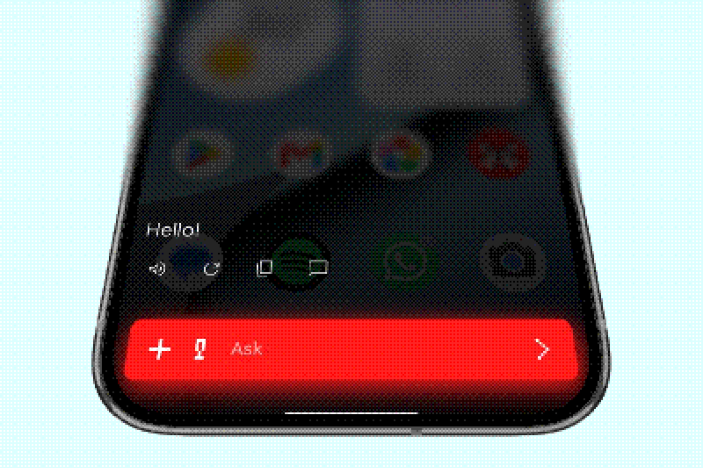

Opera for Android is the reference build. It can replace your default assistant, draw over other apps, capture the screen, and run supported models directly on the phone.

## Install

### Join the beta

The Android build is distributed as a beta. Use the beta link on [maestroai.company/opera.html](https://maestroai.company/opera.html), or install a release APK from the [GitHub releases](https://github.com/MaestroAI-Company/opera/releases).

### Build a dev client

You need Node.js, npm and the Android SDK.

```bash
npm install
npm run android
```

`npm run android` builds a debug client named **Opera Dev** (`ai.maestro.opera.dev`, blue icon). It installs next to the Play Store version, so both can coexist. Expo CLI does not see the package suffix, which is why the npm scripts pass `--app-id` for you.

```bash
npm run android:preview
```

The preview build is a release build with R8 and bundled JavaScript, without Metro. Use it when you want to measure real on-device performance.

:::tip
Debug and preview builds share the same app slot and data, so downloaded models survive switching between them. JavaScript-only changes need `npm start`; rebuild only after native changes.
:::

## Set Opera as your assistant



Opera can take the Android assistant role:

1. Open Android's **Settings → Apps → Default apps → Digital assistant app**.
2. Choose **Opera**.
3. Long-press the power button or use your usual assistant gesture.

The assistant role is optional. Opera still works as a normal app without it.

## Permissions

Opera asks for permissions only when a feature needs them:

| Permission | Used for |
| --- | --- |
| Microphone | Dictation and voice messages |
| Camera | Photos and visual questions |
| Contacts | Contact lookups and messaging tools |
| Calendar | Reading and creating events |
| Notifications | Assistant and download updates |
| Display over other apps | The overlay assistant |
| Screen capture | On-screen text selection and object detection |

Every tool can be switched off in settings. Revoking a permission disables the related tool without affecting the rest of the app.

## On-device models

On-device models use LiteRT-LM and `.litertlm` files. Download one from the model picker, or import a compatible file. Model size matters: a larger model needs more RAM and storage and will generate more slowly.

For model options and provider setup, see [Models](/docs/guides/models/).

## Troubleshooting

**The build installs but Metro cannot connect.** Make sure the phone and computer are on the same network, or use a USB connection with `adb reverse`.

**The assistant role is missing.** Some Android skins hide the default-assistant setting. Search for "assistant" in system settings, or open the app's own onboarding again.

**On-device generation is slow.** Try a smaller model, close background apps, and use the preview build when benchmarking. The first generation after loading a model is always slower.
