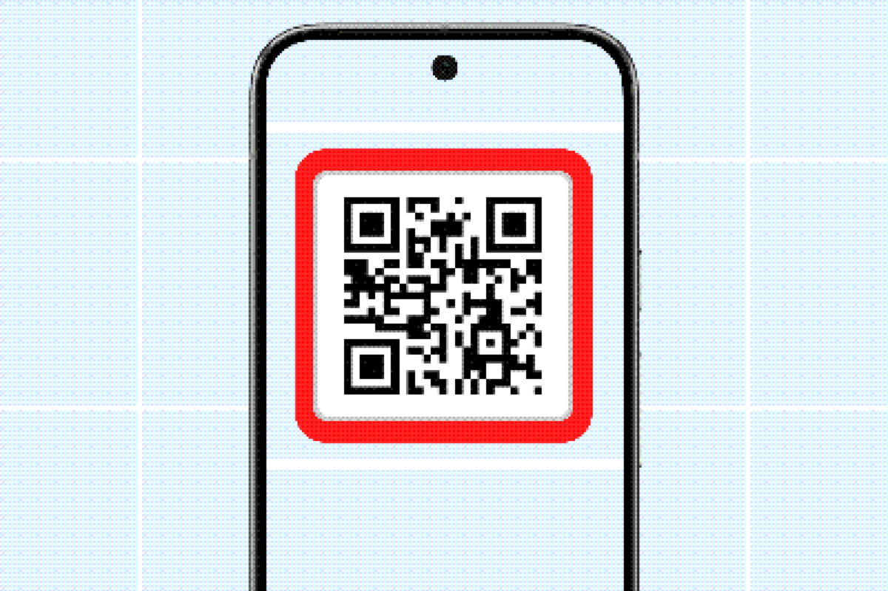
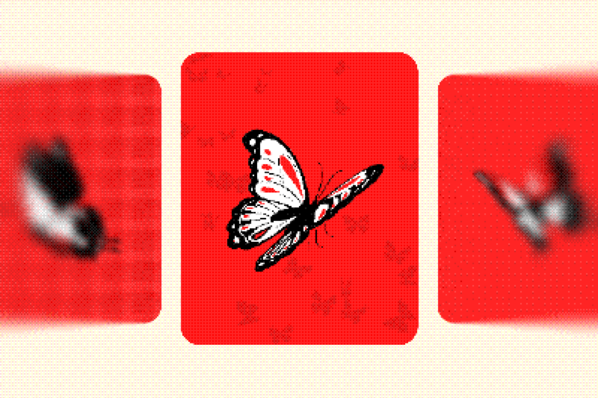

Sampler Hub is a small self-hosted server that keeps your Opera devices in sync. Install it on a computer you own, pair your phone, desktop and browser, and the hub handles the rest:

- **Sync**: conversations, settings and AI providers move between your devices.
- **Profiles**: one hub for a home or flat share. Each profile is sealed end to end; the hub stores it but cannot read it.
- **Shared AI**: Ollama, LM Studio and llama.cpp on the hub's computer can be used from every paired device, even outside your home network.
- **Local models**: the hub can download and run llama.cpp models itself, choosing the GPU backend for the machine.

There is no account and no Opera server in the middle.

## Install

### Windows

Download `sampler-hub-setup-windows-x86_64.exe` from the [latest release](https://github.com/MaestroAI-Company/sampler-hub/releases/latest) and run it. It installs for your user in `%LOCALAPPDATA%\MaestroAI-Company\Sampler-Hub` and starts with your session. A tray icon shows the pairing code and offers updates.

### macOS (Apple silicon)

Download `sampler-hub-macos-aarch64.dmg` from the latest release, or install from a terminal:

```sh
curl -fsSL https://github.com/MaestroAI-Company/sampler-hub/releases/latest/download/install.sh | sh
```

### Linux (x86_64 and arm64)

```sh
curl -fsSL https://github.com/MaestroAI-Company/sampler-hub/releases/latest/download/install.sh | sh
```

The installer verifies every file against the release `SHA256SUMS`, puts `sampler-hub` in `~/.local/bin` (change it with `SAMPLER_HUB_DIR`), and registers a systemd user service (or a launchd agent on macOS) so the hub starts with your session.

## Pair a device



On the hub's computer:

```sh
sampler-hub pair
```

The command prints a QR code and an 8-character code. Both are valid for a single pairing.

- **Phone**: scan the QR code from **Settings → Sampler Hub → Pair a hub**.
- **Desktop or browser**: type the code in the same place.

On the same network, Opera also finds the hub under **Nearby hubs**. You still have to enter the code; being on the network grants nothing.

## Profiles



A paired device picks a profile:

- **New person**: create a profile with a name and password. The first profile manages the hub; later profiles are members.
- **Existing profile**: pick it and enter its password, for example after reinstalling Opera.
- **Another device of yours**: choose **Add one of my devices**, then compare the six digits shown on both screens. The key moves between devices without a password.

The profile key is created on the device and never reaches the hub in clear. The hub keeps a copy locked by the password, and five wrong passwords lock the profile for a growing wait. A forgotten password with no device left cannot be reset.

:::danger
There is no account recovery. If every device is lost and the password is forgotten, the profile cannot be decrypted.
:::

## Manage the hub from Opera

Admin profiles can manage the hub from Opera's hub page:

- choose what each device syncs;
- rename or remove paired devices;
- turn local network discovery and provider sharing on or off;
- install hub updates;
- download, run and delete llama.cpp models.

Devices not seen for 30 days are marked inactive. Reinstalling Opera on the same device replaces its old entry.

## Local models with llama.cpp


The first model you download from Opera makes the hub install the official `llama-server` build for the machine: CUDA, Vulkan or Metal when available, CPU otherwise. Every download is checked against the digest published on GitHub. One model is loaded at a time and served to all paired devices as the **llama.cpp** provider.

## Data directories

| OS | Data directory |
| --- | --- |
| Windows | `%LOCALAPPDATA%\MaestroAI-Company\Sampler-Hub\data` |
| macOS | `~/Library/Application Support/company.MaestroAI-Company.Sampler-Hub` |
| Linux | `~/.local/share/samplerhub` |

## Build from source

You need a recent stable Rust toolchain.

```sh
cargo build --release -p sampler-hub
cargo build --release -p sampler-hub --no-default-features
cargo test --workspace
```

The second command builds the headless hub without the tray app. See the [Sampler Hub CLI reference](/docs/reference/hub-cli/) for commands and service management.
